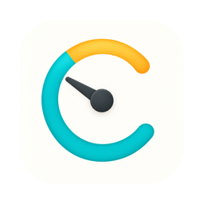
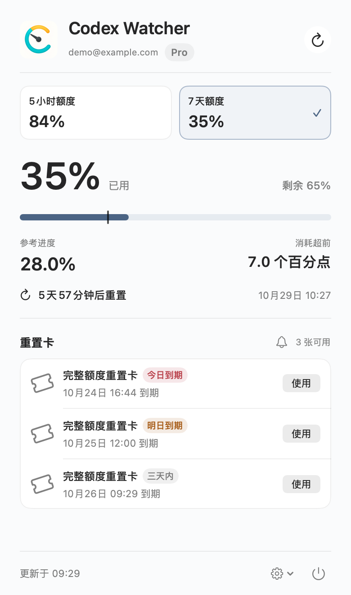
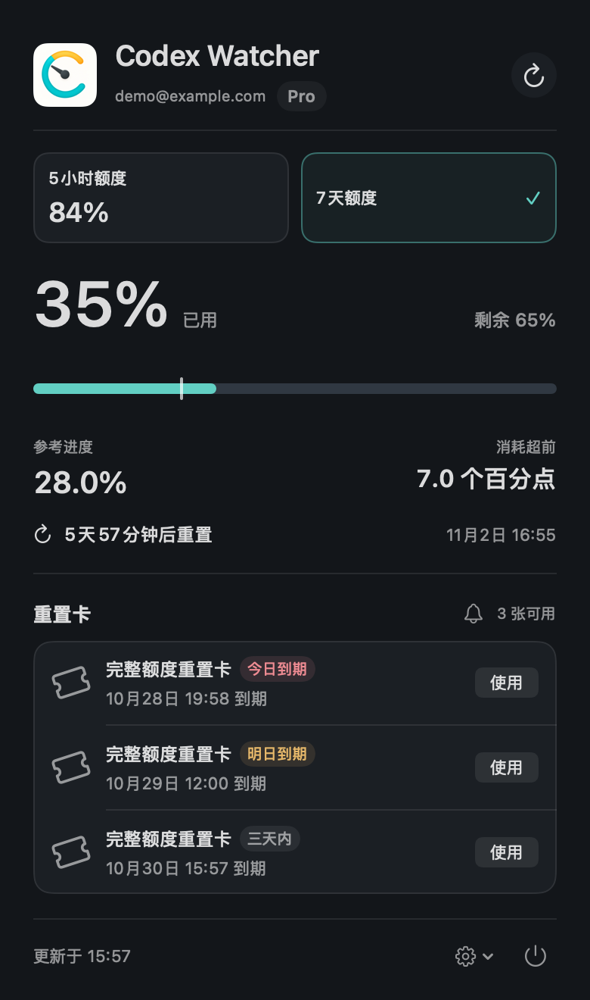

# Codex Watcher



原生 macOS 菜单栏工具，查看 Codex 已用额度、时间进度和重置卡，掌握用量是否超前。

A native macOS menu bar app for tracking Codex usage, quota pace, and reset cards.

> 独立第三方开源项目，与 OpenAI 无隶属关系。目前为预览版；真实重置操作未验收。

## 下载与安装

**[下载最新版（DMG / ZIP）](https://github.com/ximatai/CodexWatcher/releases/latest)** · [全部版本与更新说明](https://github.com/ximatai/CodexWatcher/releases)

支持 **macOS 14+**，提供 **Universal 安装包（Apple Silicon + Intel）**，已通过 Developer ID 签名和 Apple 公证。Intel 尚未经真机验证。

1. 打开最新版下载页，在 **Assets** 中选择 `.dmg`，打开后将 CodexWatcher 拖入 Applications；也可下载 `.zip`，解压后移动应用。
2. 单独安装 [Codex CLI](https://learn.chatgpt.com/docs/app-server)，打开应用，点击「使用 ChatGPT 连接」登录。

校验文件为 `SHA256SUMS.txt`；GitHub 自动生成的 `Source code` 压缩包不包含可直接运行的应用。

## 界面预览

<p>
  
  
</p>

亮色与暗色面板。以上由当前应用视图生成，账号、用量和卡片均为虚构演示数据。

## 功能

- 菜单栏显示已用百分比，可配置图标、时间进度和用量偏移。
- 对比实际用量与自然时间进度，显示下次重置时间和倒计时。
- 查看重置卡数量、有效期及临期标记，手动使用前二次确认。
- 可选到期前 15 分钟提醒或自动使用，默认关闭，启用自动模式时明确授权（`v0.2.2` 起提供）。
- 支持亮色、暗色和跟随系统；日期、时间和数字遵循系统地区设置。
- 可配置登录 macOS 时启动，自动启动时仅显示状态栏。
- 可隐藏邮箱；凭证由本机 Codex CLI 的系统钥匙串存储管理。

默认每 5 分钟读取用量；启用临期处理时每 30 秒检查，打开面板及系统唤醒等事件也会触发刷新。应用不发起模型推理、不读取聊天内容，也不使用开发者自建后端。

## 从源码运行

需要 **macOS 14+**、可打开本项目的 **Xcode**，以及单独安装的 **Codex CLI**。已验证 Xcode 27.1、CLI 0.163.0；其他版本及账号套餐的可用字段可能不同。

```sh
git clone https://github.com/ximatai/CodexWatcher.git
cd CodexWatcher
open CodexWatcher.xcodeproj
```

在 Xcode 中选择 `CodexWatcher` → `My Mac` 运行，需要签名时选择自己的 Development Team。安装 CLI 请参考 [OpenAI 官方文档](https://learn.chatgpt.com/docs/app-server)。

启动后会显示面板和菜单栏入口，不常驻 Dock。点击「使用 ChatGPT 连接」，在官方浏览器页面登录；CLI 不在默认路径时，可从齿轮菜单选择。

更多构建命令、测试和兼容性说明见 [开发与接入](docs/DEVELOPMENT.md)。

## 如何理解用量

**偏移 = 实际用量 − 自然时间进度。** 例如已用 35%、时间已过 28%，偏移为 **+7 个百分点**，表示用量超前。自然时间包含睡眠和休息时间。

时间基准由服务器返回的窗口长度与重置时间推算；数据失效时停止展示偏移。详细口径、状态栏配置和重置卡说明见 [使用指南](docs/USAGE.md)。

**重置会消耗卡片且无法撤销；超时后的重试仍是写操作，可能完成首次消费。** 开发测试不消费真实卡片。

## 文档与素材

- [使用指南](docs/USAGE.md)：用量口径、设置、重置确认与重试。
- [开发与接入](docs/DEVELOPMENT.md)：构建、测试、依赖及认证适用范围。
- [发布流程](docs/RELEASING.md)：打 tag 后自动测试、签名、公证及发布。
- [图标素材](docs/design/README.md)：1024 方形原稿、macOS 图标及生成方式。
- [界面预览素材](docs/images/README.md)：演示数据与重新生成方式。
- [贡献指南](CONTRIBUTING.md) · [架构](docs/ARCHITECTURE.md) · [安全与隐私](SECURITY.md) · [更新记录](CHANGELOG.md)

采用 [MIT License](LICENSE)。OpenAI、ChatGPT 与 Codex 名称及商标属于各自权利人；代码许可证不授予相关服务访问权。
