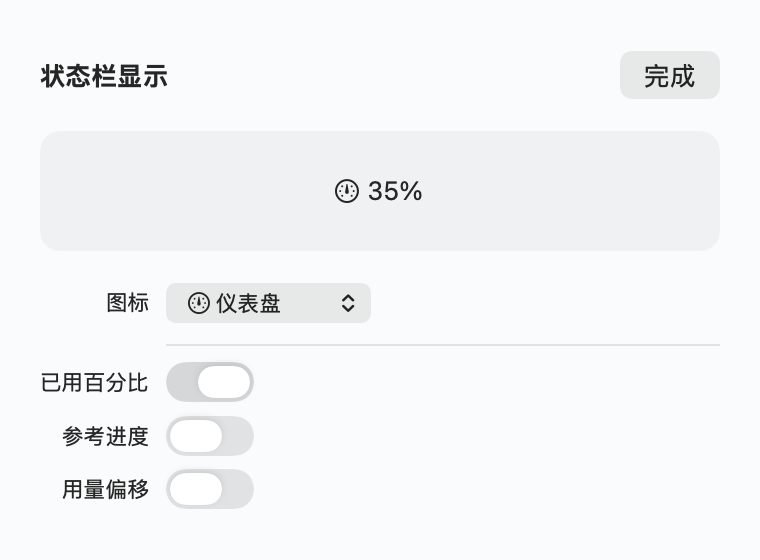
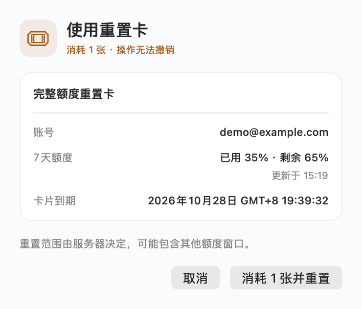
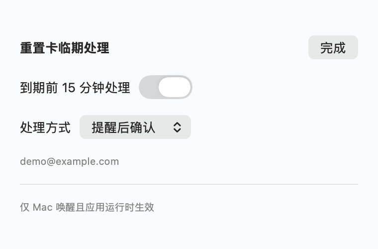

# 使用指南

[返回 README](../README.md)

## 登录与刷新

启动后点击「使用 ChatGPT 连接」，在官方浏览器页面登录。应用独立保存登录状态，不直接复用其他 Codex 客户端的配置。

默认每 5 分钟读取用量；打开面板、系统唤醒及账号变更也会刷新，可点击面板右上角手动刷新。实际用量来自最近一次成功读取，并非秒级实时数据。

默认查看 Codex 中最长的额度窗口；服务器提供多个窗口时可切换。套餐、额度窗口及重置卡字段由服务端决定，缺失信息不视为零。

## 用量与时间基准

```text
周期起点（推算） = 下次重置时间 − 窗口长度
标准用量 = 已过去的周期时间 / 窗口长度 × 100%
偏移 = 实际用量 − 标准用量
```

例如实际用量 35%、标准用量 28%，偏移为 **+7 个百分点**。正值表示消耗超前，负值表示滞后；自然时间包含睡眠和休息时间。

窗口起点由服务器返回值推算，不是明确提供的历史起点。手动重置若保留原窗口终点，基准仍按原窗口计算。缺失窗口长度或已到重置时间时，不推算偏移。

读取失败、超过 10 分钟未更新或当前周期已结束时，面板、状态栏和设置预览停止展示偏移；保留最后读取的用量及仍可计算的时间进度，刷新成功后恢复。面板底栏显示更新时间。

## 状态栏与外观

左键点击状态栏打开用量面板，右键或 Control 点按打开设置菜单；面板底栏齿轮提供相同入口。

「状态栏显示…」可以选择仪表盘、用量图表、闪电、圆环或无图标，并独立开关已用百分比、时间进度和偏移。启用的文本按此顺序排列，偏移单位 `pp` 表示百分点。数值对应当前选择的额度窗口，至少保留图标或一项文本。



设置实时预览并自动保存。外观支持亮色、暗色和跟随系统；菜单栏图标跟随系统菜单栏背景。日期、时区、12/24 小时制和数字使用系统格式，界面目前主要为简体中文。

「隐藏邮箱」位于齿轮和状态栏右键菜单。开启后遮盖邮箱，确认页显示「已隐藏」，辅助功能及悬停提示不读出邮箱原值；其余数据与操作照常显示。

## 登录时启动

在齿轮菜单或状态栏右键菜单中开启「登录时启动」，下次登录 macOS 时会在状态栏运行，不自动弹出主面板。手动打开应用仍显示面板。

该选项使用 macOS 登录项管理，读取系统实际状态。若显示「待系统允许」，选择「在系统设置中允许…」完成授权；取消勾选可撤销待允许的请求。在系统设置中修改后，切回应用或重新打开右键菜单即可同步。

请将正确签名的应用放在固定位置（建议“应用程序”文件夹）后开启。无签名的源码构建可能被系统拒绝注册，应用会显示错误，不会把失败显示为已开启。

## 重置卡

数量以服务端返回值为准，详情列表可能少于总数。未提供到期时间不代表永久有效。临期标签按本地日期区分：红色「今日到期」、橙色「明日到期」，其余三天内到期显示蓝色「三天内」。只有标签着色，卡片行保持统一背景。已过期或超过三天的卡片不显示临期标签。

点击「使用」只打开确认页，展示账号、当前用量、更新时间和卡片到期时间。确认页不会通过回车键直接提交。



手动操作确认「消耗 1 张并重置」后才会发送写请求，且无法撤销。实际重置范围由服务器决定，可能包含其他额度窗口。真实重置操作尚未验收。

确认页绑定打开时的账号、卡片及原重试标识；后台操作变化时会禁止提交，需取消后重新打开。新操作发送前再次核实账号及卡片，并持久化请求标识。

### 到期前 15 分钟处理

此功能从 `v0.2.2` 开始提供；`v0.2.1` 及更早安装包不包含此配置。

在齿轮菜单或状态栏右键菜单选择「重置卡临期处理…」。默认关闭，可先选择处理方式再开启：

- **提醒后人工确认**：需要允许系统通知。卡片进入到期前 15 分钟范围后发送通知；点击「查看并确认」打开原有二次确认页，不直接使用卡片。通知正文不包含邮箱。
- **自动使用**：启用时需要确认授权；授权固定弹窗打开时的账号，账号变化后需重新确认。卡片临期后直接尝试使用，**已用额度为 0% 时也会尝试**；服务端决定实际消费与重置结果。需要服务端提供稳定的账号标识。



设置绑定启用时的账号，当前账号不匹配时暂停；为其他账号启用需先关闭再开启。多张卡按到期时间排序，每次检查最多处理一张；每张卡的请求标识和自动尝试次数持久化，重启或多实例共用最多 3 次的限额。提醒每张卡成功提交一次，系统专注模式、通知设置可能影响实际展示；发送失败可在后续检查重试。

仅在应用运行、Mac 唤醒且能读取账号时执行，每 30 秒检查并刷新服务端状态，可能有约 30 秒加网络延迟的偏差。休眠或退出期间不执行；唤醒后补查尚未到期且已进入 15 分钟范围的卡片，不补用过期卡。临期功能关闭时仍按默认 5 分钟刷新。

自动使用会重新核对账号、原到期时间及可用状态。异常或结果未知时，间隔至少 30 秒重试同一张卡，首次加重试总计最多 3 次；始终使用同一账号、卡片 ID、原到期时间和幂等键，不会改用其他日期的卡片。收到明确结果即停止，不为重复消费凑足次数。账号不匹配、卡片消失或到期时间变化、卡片已过期时停止自动重试；3 次仍未确认则保留原请求供人工核实，期间不自动使用其他卡片。旧版本或手动创建的待确认请求不会被接管为自动重试。**自动使用会消耗重置卡且无法撤销。**

### 超时与重试

超时不代表失败。「重试上次重置」会复用原请求标识并重发原写操作；若此前尚未完成，可能消耗 1 张卡，并非只读查询。

不要删除本地待确认记录，也不要把未知结果改成全新请求。同一幂等键用于避免重复消费，但实际服务端行为仍依赖官方接口。开发测试仅使用隔离的假服务，不消费真实卡片。

## 常见问题

- **找不到 CLI**：默认查找 `/opt/homebrew/bin/codex` 或 `/usr/local/bin/codex`；可从齿轮菜单选择可信的可执行文件。
- **没有 Dock 图标**：这是菜单栏工具，可从状态栏进入面板。
- **没有重置卡或详情不全**：取决于套餐及服务器返回的字段，不能据此判断所有账号都支持该功能。
- **偏移显示「待更新」**：先手动刷新；缺失窗口长度或周期已结束时，需要等待服务端提供有效数据。

更多凭证与本地数据说明见 [安全与隐私](../SECURITY.md)。
